<div align="center">

# 🏁 Racing Hub

**Formula 1, WEC и Formula E на одном сайте: календарь, результаты, зачёты, профили и графики**

[](https://github.com/Ait102/racinghub/actions/workflows/ci.yml)
[](https://github.com/Ait102/racinghub/actions/workflows/api-health.yml)


### [🌐 Открыть сайт](https://ait102.github.io/racinghub/)

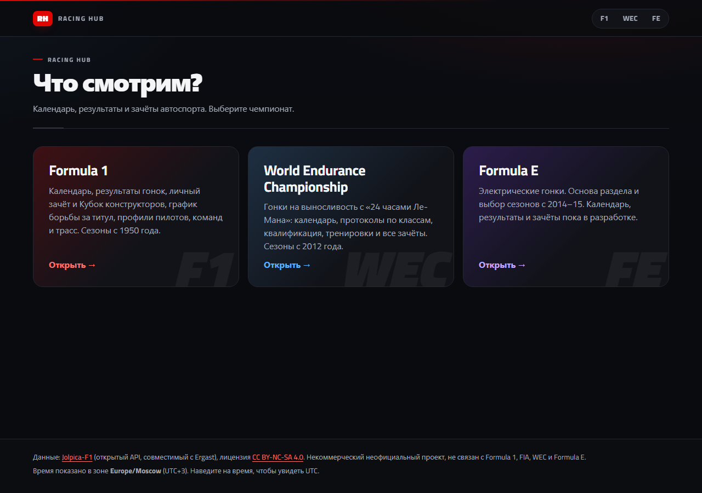

</div>

> [!IMPORTANT]
> **Фанатский личный проект.** Некоммерческий, без рекламы и доходов. Не связан с Formula 1, FIA, WEC, Formula E, организаторами и командами и не одобрен ими. Подробнее — в разделе [«Права и источники»](#-права-и-источники).

## 🏎 Три чемпионата

|               | 🔴 **Formula 1**                                    | 🔵 **WEC — выносливость**                                                              | 🟣 **Formula E**                                                       |
| ------------- | --------------------------------------------------- | -------------------------------------------------------------------------------------- | ---------------------------------------------------------------------- |
| **Сезоны**    | все с 1950 года                                     | все с 2012 года, включая «суперсезоны» 2018–19 и 2019–20                               | все с 2014–15                                                          |
| **Главная**   | ближайший Гран-при с отсчётом, подиум, лидеры       | прогресс сезона, ближайшая гонка, победители классов, лидеры                           | прогресс сезона, ближайший E-Prix, подиум, поул, быстрый круг, лидеры  |
| **Этап**      | гонка, квалификация, спринт, пит-стопы, расписание  | протокол по классам, квалификация с Hyperpole, тренировки                              | протокол, группы и дуэли квалификации, сдвоенные этапы Race 1 / Race 2 |
| **Трасса**    | схема конфигурации того года, длина, повороты       | схема, длина, повороты и короткое описание                                             | сведения из статьи гонки, история E-Prix по годам                      |
| **Зачёты**    | личный и Кубок конструкторов                        | пилоты, производители и команды; знаки классов HYPER CAR и LM GT3                      | пилоты, команды (обе машины), производители                            |
| **График**    | очки после каждого этапа — борьба за титул          | место в каждой гонке: выделение линии, пунктир, строка «сход»                          | место в каждой гонке, как в WEC                                        |
| **Профили**   | пилоты, команды и трассы: карьера, титулы, фото     | пилоты (сведения, биография), команды с машинами сезона, трассы                        | пилоты и команды с цифрами карьеры из Википедии, E-Prix, фото машины   |
| **Сравнение** | два пилота рядом                                    | два пилота рядом, по сезонам                                                           | два пилота: цифры карьеры и итоги по сезонам                           |
| **Избранное** | ⭐ подсветка в таблицах, на графике и на главной    | ⭐ подсветка в списках и зачётах, блок на главной                                      | ⭐ звёздочка в профилях и зачётах, блок на главной                     |
| **Источник**  | [Jolpica-F1](https://github.com/jolpica/jolpica-f1) | [английская Википедия](https://en.wikipedia.org/wiki/FIA_World_Endurance_Championship) | [английская Википедия](https://en.wikipedia.org/wiki/Formula_E)        |

**Везде:** телефон и компьютер · тёмная тема (F1 — чёрно-красная, WEC — чёрно-синяя, Formula E — чёрно-фиолетовая) · управление с клавиатуры · анимации с учётом «уменьшить движение» · флаги, номера, эмблемы команд и марок (в WEC и Formula E — и у клиентских команд по их машинам) · свободные фото с подписью автора.

## 🟣 Formula E

Чемпионат мира на электромобилях: городские трассы, этапы часто сдвоенные (две гонки в один уикенд), квалификация — группы и дуэли на выбывание.

<table>
  <tr>
    <td width="50%">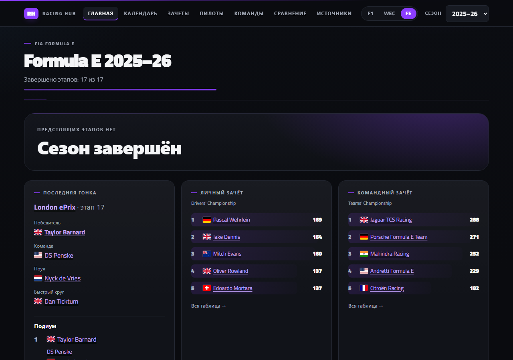</td>
    <td width="50%">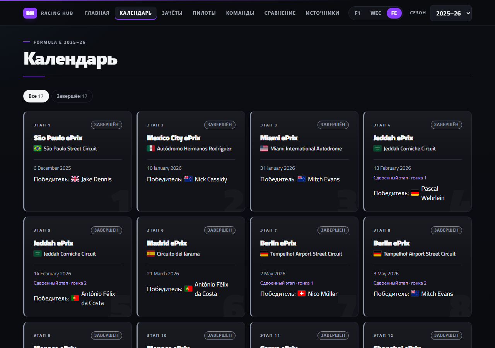</td>
  </tr>
  <tr>
    <td align="center"><b>Главная</b> — подиум, поул, быстрый круг и лидеры</td>
    <td align="center"><b>Календарь</b> — сдвоенные этапы и победители</td>
  </tr>
  <tr>
    <td>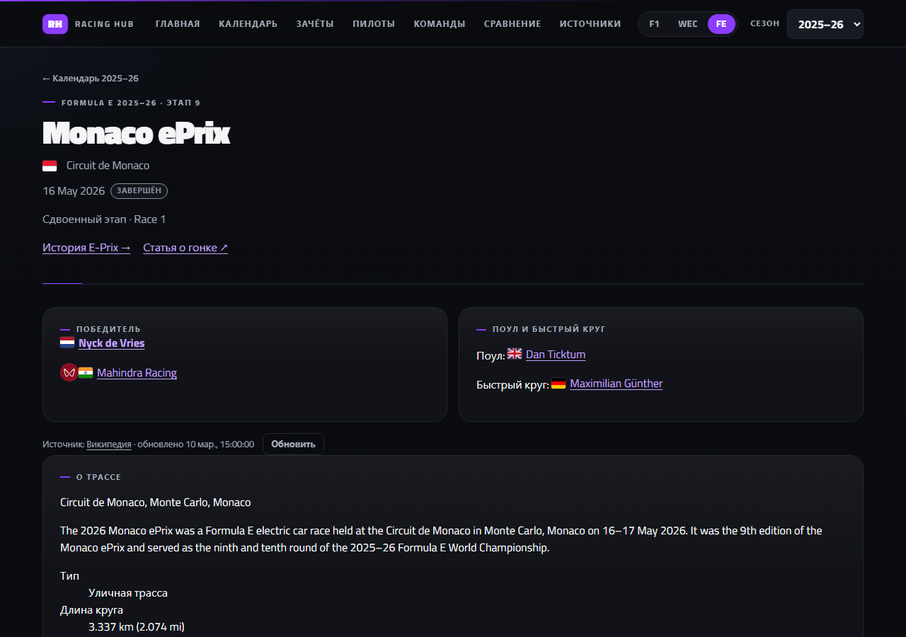</td>
    <td>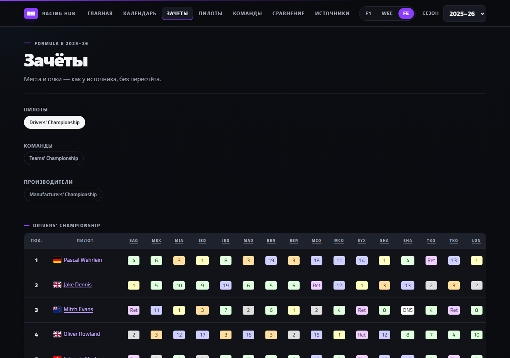</td>
  </tr>
  <tr>
    <td align="center"><b>Этап</b> — протокол, группы и дуэли</td>
    <td align="center"><b>Зачёты</b> — пилоты, команды, производители</td>
  </tr>
</table>

> [!NOTE]
> Официальный API Formula E недоступен, поэтому, как и для WEC, данные берутся из английской Википедии. Цифры карьеры в профилях (старты, победы, подиумы, поулы, титулы) — из карточки статьи, как их публикует Википедия. Фото машины команды показывается, только если в подписи снимка указана модель этого сезона. Подробнее — в [FE README](src/series/fe/README.md).

## 🔵 WEC

Чемпионат мира по гонкам на выносливость с «24 часами Ле-Мана»: в одной гонке едут несколько классов (сейчас **Hypercar** и **LMGT3** — на сайте у них знаки «HYPER CAR» и «LM GT3» в цветной рамке), на одной машине — экипаж из 2–3 пилотов, гонка длится от нескольких часов до суток.

<table>
  <tr>
    <td width="50%">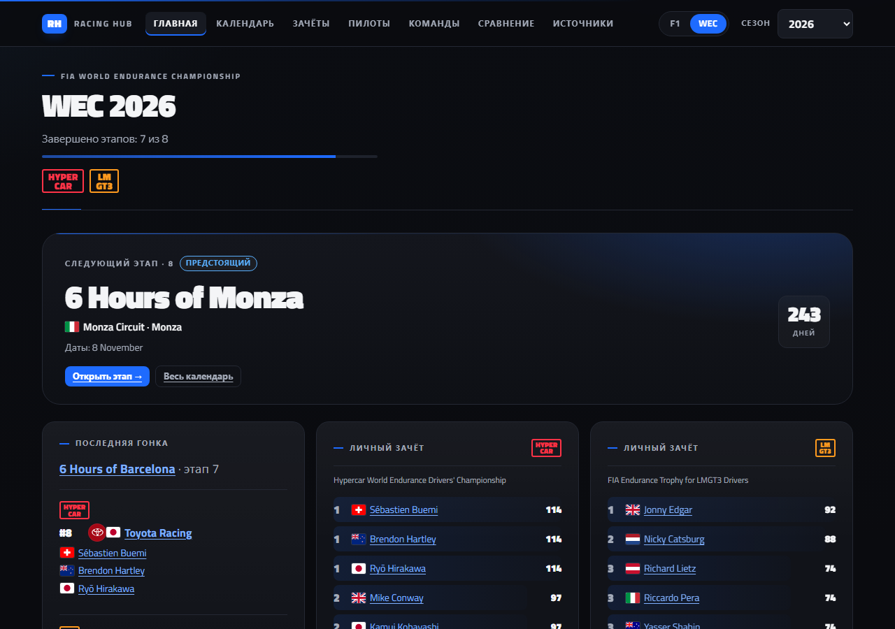</td>
    <td width="50%">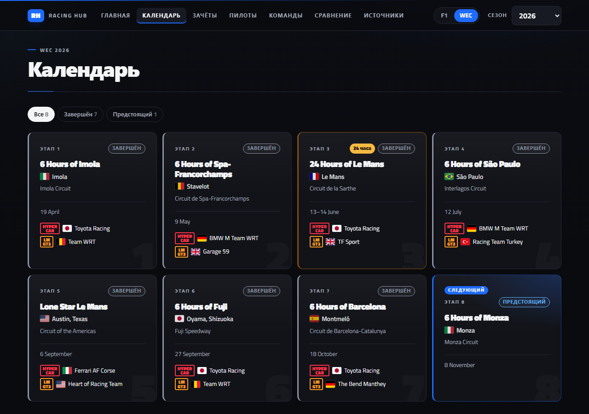</td>
  </tr>
  <tr>
    <td align="center"><b>Главная</b> — прогресс сезона и лидеры классов</td>
    <td align="center"><b>Календарь</b> — победители каждого класса</td>
  </tr>
  <tr>
    <td>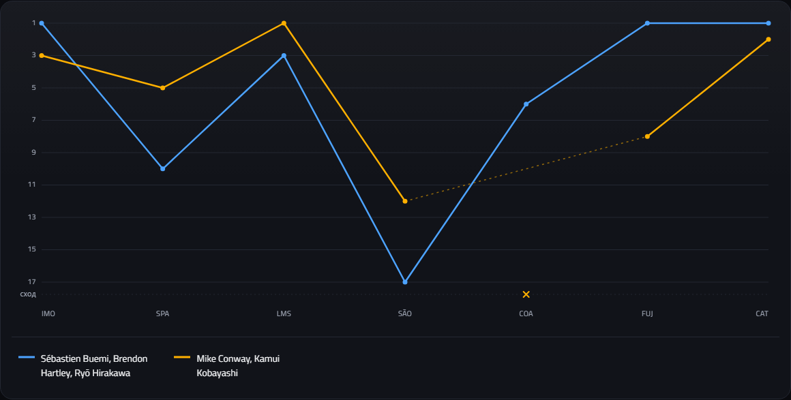</td>
    <td>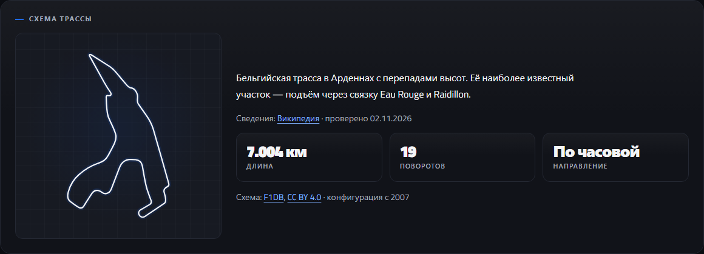</td>
  </tr>
  <tr>
    <td align="center"><b>График</b> — место экипажа в каждой гонке</td>
    <td align="center"><b>Трасса</b> — схема, длина, повороты</td>
  </tr>
</table>

> [!NOTE]
> Бесплатного стабильного API для WEC нет, поэтому данные берутся из английской Википедии: там есть все сезоны в одинаковых таблицах. Результаты появляются через несколько часов или на следующий день после гонки. График показывает **место в гонке**, а не положение в чемпионате: очков после каждого этапа у источника нет, а пересчитывать их сайт не будет. Подробнее — в [WEC README](src/series/wec/README.md).

## 🔴 Formula 1

<table>
  <tr>
    <td width="50%">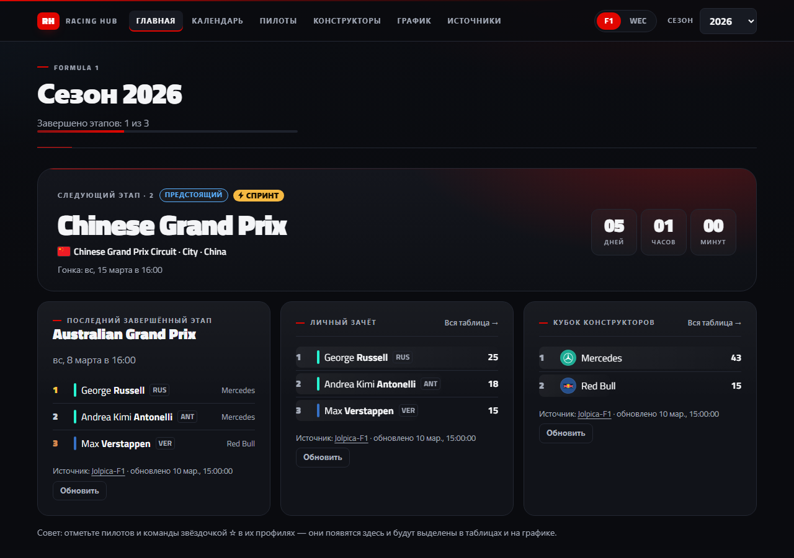</td>
    <td width="50%">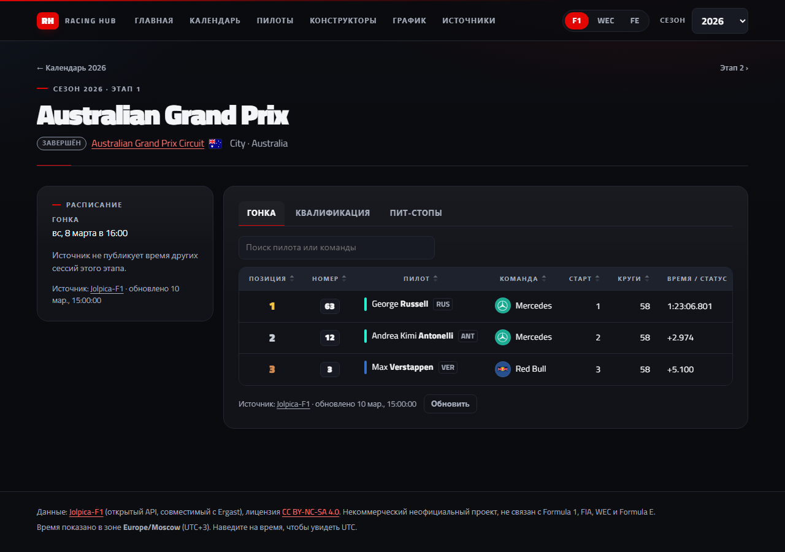</td>
  </tr>
  <tr>
    <td align="center"><b>Главная</b> — ближайший Гран-при и лидеры</td>
    <td align="center"><b>Этап</b> — схема трассы, расписание и результаты</td>
  </tr>
  <tr>
    <td>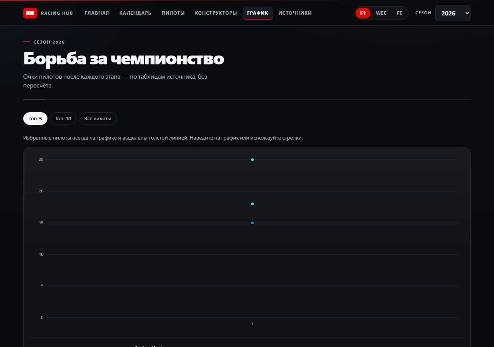</td>
    <td></td>
  </tr>
  <tr>
    <td align="center"><b>График</b> — борьба за титул по этапам</td>
    <td align="center"><b>Профиль</b> — сезон, карьера, фото</td>
  </tr>
</table>

Квалификации у Jolpica есть с 1994 года, пит-стопы — с 2011. Тренировок и спринт-квалификации у источника нет.

## 🔎 Правила данных

- 📊 Очки и места — **как у источника**, сайт ничего не пересчитывает.
- ❔ Нет данных — «—» или «нет у источника», значения **не придумываются**.
- 🔗 Под каждым блоком — источник, время загрузки и кнопка «Обновить».
- 📷 Фото только с Wikimedia Commons и под свободной лицензией, автор подписан. Нет подходящего фото — нет фото.
- 🔐 Ни ключей API, ни регистрации, ни бэкенда: всё читается из открытых источников прямо в браузере.
- 💾 Если источник недоступен, показывается последняя сохранённая копия с пометкой.

## 🚀 Запуск

```bash
npm install
npm run dev
```

Откройте **http://localhost:5173**.

<details>
<summary><b>Все команды</b></summary>

| Команда                 | Что делает                                                                |
| ----------------------- | ------------------------------------------------------------------------- |
| `npm run dev`           | сайт для разработки с автообновлением                                     |
| `npm run build`         | проверка типов и сборка в `dist/`                                         |
| `npm run preview`       | просмотр собранного сайта                                                 |
| `npm test`              | модульные и компонентные тесты (Vitest)                                   |
| `npm run test:e2e`      | сквозные тесты в браузере (первый раз: `npx playwright install chromium`) |
| `npm run test:contract` | проверка живых источников: Jolpica и Википедии                            |
| `npm run test:visual`   | сравнение скриншотов страниц с эталонами                                  |
| `npm run lint`          | ESLint                                                                    |
| `npm run format`        | Prettier                                                                  |

</details>

## 🧱 Как устроено

**React 18** · **TypeScript (strict)** · **Vite 8** · **React Router 7** · **Vitest** · **Playwright** · **ESLint** · **Prettier** — без UI-библиотек и бэкенда, стили на обычном CSS, графики и схемы на SVG.

```text
src/
├── api/          HTTP-клиент, общий клиент Википедии и фото с Commons
├── components/   шапка, таблицы, фото, эмблемы, схема трассы, избранное
├── data/         общие схемы трасс и эмблемы марок
├── hooks/        загрузка данных, время, хранилище избранного
├── lib/          даты, флаги, разбор таблиц, зачётов и статей Википедии, модель графика мест
├── styles/       тема и стили разделов
└── series/
    ├── f1/       Formula 1: Jolpica, страницы, график очков
    ├── wec/      WEC: Википедия, страницы, классы, график мест
    └── fe/       Formula E: Википедия, гонки и квалификация, профили, график мест
```

- Страницы серий загружаются **отдельными частями** через `lazy`.
- Серии **не импортируют друг друга**, общий код не зависит от серий — это проверяет ESLint.
- Сайт хостится на **GitHub Pages**: после пуша в `main` проверки прогоняются заново, и сайт публикуется, только если все они прошли.

<details>
<summary><b>Все адреса страниц</b></summary>

| Адрес                                           | Что показывает                                     |
| ----------------------------------------------- | -------------------------------------------------- |
| `#/`                                            | выбор чемпионата                                   |
| `#/f1`, `#/wec`, `#/fe`                         | последний (или последний просмотренный) сезон      |
| `#/{season}`                                    | F1: главная сезона                                 |
| `#/{season}/calendar`, `/race/{round}`          | F1: календарь и этап                               |
| `#/{season}/drivers`, `/constructors`           | F1: личный зачёт и Кубок конструкторов             |
| `#/{season}/chart`, `/compare?a=…&b=…`          | F1: график чемпионства и сравнение                 |
| `#/{season}/driver/{id}`, `/constructor/…`      | F1: профили пилота и команды                       |
| `#/{season}/circuit/{id}`                       | F1: трасса и победители по годам                   |
| `#/about`                                       | F1: источники данных                               |
| `#/wec/{season}`                                | WEC: главная сезона                                |
| `#/wec/{season}/calendar`, `/race/{round}`      | WEC: календарь и этап                              |
| `#/wec/{season}/standings`                      | WEC: все зачёты и график мест                      |
| `#/wec/{season}/drivers`, `/teams`              | WEC: заявочные списки с поиском                    |
| `#/wec/{season}/crews`                          | WEC: номера машин, составы экипажей и этапы        |
| `#/wec/{season}/compare?a=…&b=…`                | WEC: сравнение пилотов                             |
| `#/wec/{season}/driver/…`, `/team/…`            | WEC: профили пилота и команды (по названию статьи) |
| `#/wec/{season}/circuit/…`                      | WEC: трасса и победители гонки по годам            |
| `#/wec/{season}/about`                          | WEC: источники данных, фото, схем и эмблем         |
| `#/fe/{season}`                                 | FE: главная сезона                                 |
| `#/fe/{season}/calendar`, `/race/{round}`       | FE: календарь, гонка и квалификация                |
| `#/fe/{season}/standings`, `/about`             | FE: зачёты, график мест и источники                |
| `#/fe/{season}/drivers`, `/teams`               | FE: заявочные списки с поиском                     |
| `#/fe/{season}/driver/…`, `/team/…`, `/eprix/…` | FE: профили пилота, команды и E-Prix               |
| `#/fe/{season}/compare?a=…&b=…`                 | FE: сравнение пилотов                              |

</details>

## ✅ Качество

Каждое изменение проходит модульные и компонентные тесты, сквозные сценарии в браузере, сравнение скриншотов, проверку типов, ESLint и Prettier. Тесты идут параллельно в несколько потоков: модульные — около 30 секунд, браузерные сценарии и скриншоты страниц — тоже одновременно. Отдельная проверка каждый понедельник следит, что Jolpica и Википедия отвечают в прежнем формате. Результаты Formula 1 сверены с официальным сайтом. Цифры и даты прогонов — в [отчёте о тестировании](docs/TESTING.md), поддержка проекта — в [docs/MAINTENANCE.md](docs/MAINTENANCE.md).

## 📄 Права и источники

Racing Hub — **неофициальный фанатский проект**, сделанный для себя: без рекламы, платного доступа и доходов.

| Что                    | Откуда                                                                                                                                                                                 | Лицензия                                                              |
| ---------------------- | -------------------------------------------------------------------------------------------------------------------------------------------------------------------------------------- | --------------------------------------------------------------------- |
| Данные Formula 1       | [Jolpica-F1](https://github.com/jolpica/jolpica-f1)                                                                                                                                    | [CC BY-NC-SA 4.0](https://creativecommons.org/licenses/by-nc-sa/4.0/) |
| Данные WEC и Formula E | [английская Википедия](https://en.wikipedia.org/), ссылка на статью — под каждым блоком                                                                                                | [CC BY-SA 4.0](https://creativecommons.org/licenses/by-sa/4.0/)       |
| Схемы трасс            | [F1DB](https://github.com/f1db/f1db); Ле-Ман и Себринг — © [участники OpenStreetMap](https://www.openstreetmap.org/copyright) через [track-atlas](https://github.com/tobi/track-atlas) | CC BY 4.0; [ODbL 1.0](https://opendatacommons.org/licenses/odbl/1-0/) |
| Фото                   | [Wikimedia Commons](https://commons.wikimedia.org/), автор и лицензия — под каждым фото                                                                                                | свободные лицензии авторов                                            |
| Флаги                  | [flag-icons](https://github.com/lipis/flag-icons); в WEC и Formula E — из Википедии                                                                                                    | MIT; общественное достояние                                           |
| Эмблемы                | Commons и Википедия; источник каждой — в [logos.ts](src/series/f1/data/logos.ts) и [emblems.ts](src/data/emblems.ts), для WEC и Formula E — на страницах «Источники»                   | товарные знаки владельцев                                             |

«Formula 1», «F1», «FIA», «WEC», «Formula E», названия и логотипы команд — товарные знаки их владельцев. Эмблемы нужны только чтобы обозначить участника. Если вы правообладатель и хотите убрать материал, [создайте issue](https://github.com/Ait102/racinghub/issues) — он будет удалён.
