<div align="center">

# 🏁 Racing Hub

**Пять чемпионатов на одном сайте: календарь, результаты, зачёты, схемы трасс, профили и графики**


<br />


### [🌐 Открыть сайт](https://ait102.github.io/racinghub/)

[Серии](#-пять-серий) · [Возможности](#-что-есть-на-сайте) · [F1](#-formula-1) · [WEC](#-wec) · [Formula E](#-formula-e) · [IMSA и DTM](#-imsa-и--dtm) · [Запуск](#-запуск) · [Права](#-права-и-источники)

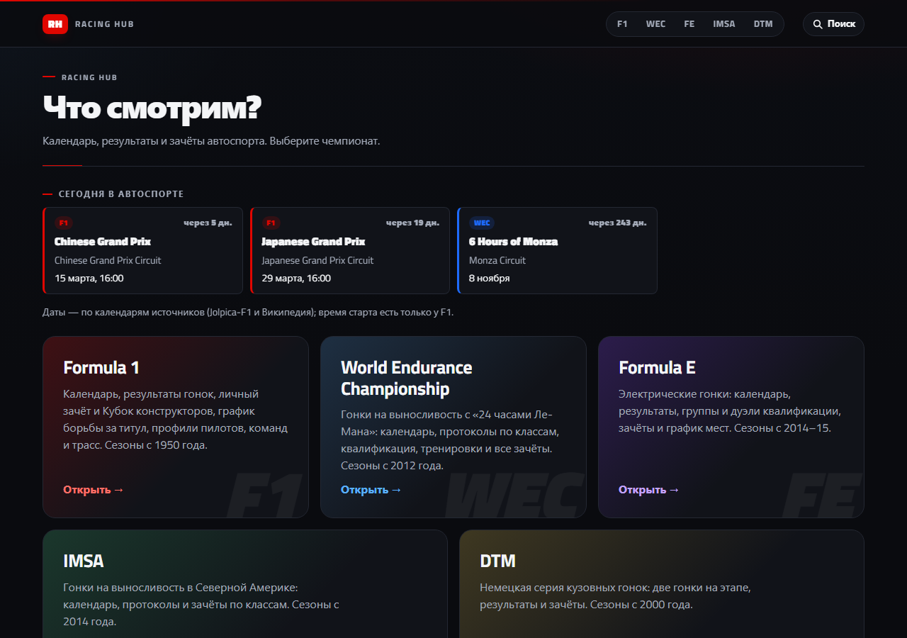

</div>

> [!IMPORTANT]
> **Фанатский личный проект.** Некоммерческий, без рекламы и доходов. Не связан с Formula 1, FIA, WEC, Formula E, IMSA, DTM, организаторами и командами и не одобрен ими. Подробнее — в разделе [«Права и источники»](#-права-и-источники).

## 🏎 Пять серий

|     | Серия                        | Сезоны    | Чем особенная                                                     | Откуда данные                                       |
| --- | ---------------------------- | --------- | ----------------------------------------------------------------- | --------------------------------------------------- |
| 🔴  | **[Formula 1](#-formula-1)** | с 1950    | Гран-при, спринты, Кубок конструкторов                            | [Jolpica-F1](https://github.com/jolpica/jolpica-f1) |
| 🔵  | **[WEC](#-wec)**             | с 2012    | выносливость, классы Hypercar и LMGT3, экипажи, «24 часа Ле-Мана» | Википедия, официальные зачёты по этапам             |
| 🟣  | **[Formula E](#-formula-e)** | с 2014–15 | электромобили, городские трассы, сдвоенные этапы, дуэли           | Википедия, официальные классификации FIA            |
| 🟢  | **[IMSA](#-imsa-и--dtm)**    | с 2014    | выносливость в Северной Америке: GTP, LMP2, GTD Pro, GTD          | Википедия, официальные результаты IMSA              |
| 🟡  | **[DTM](#-imsa-и--dtm)**     | с 2000    | немецкие кузовные гонки, две гонки на этапе                       | Википедия, официальный API dtm.com                  |

**На главной** — «Сегодня в автоспорте»: ближайшие гонки всех серий с отсчётом. **В шапке** — общий поиск пилотов, команд и трасс текущих сезонов всех пяти серий.

## ✨ Что есть на сайте

|                        | 🔴 F1                           | 🔵 WEC                              | 🟣 FE                          | 🟢 IMSA                    | 🟡 DTM                     |
| ---------------------- | ------------------------------- | ----------------------------------- | ------------------------------ | -------------------------- | -------------------------- |
| **Главная сезона**     | ✅ отсчёт, подиум, лидеры       | ✅ прогресс, победители классов     | ✅ отсчёт, подиум, поул, круг  | ✅ ближайшая гонка, лидеры | ✅ последняя гонка, лидеры |
| **Календарь**          | ✅                              | ✅ победители классов               | ✅ сдвоенные этапы             | ✅ классы этапа            | ✅ обе гонки этапа         |
| **Расписание уикенда** | ✅                              | ✅                                  | ✅                             | ✅ прошедшие сессии        | ✅ и для будущих этапов    |
| **Сессии этапа**       | квалификация, спринт, пит-стопы | квалификация, Hyperpole, тренировки | квалификация, тренировки       | все сессии                 | все сессии                 |
| **Схема трассы**       | ✅ конфигурация того года       | ✅                                  | ✅ подтверждённые              | ✅ 12 трасс                | ✅ почти все               |
| **Зачёты**             | пилоты, конструкторы            | пилоты, производители, команды      | пилоты, команды, производители | все классы                 | пилоты, команды, марки     |
| **График очков**       | ✅ все сезоны                   | 2025–2026                           | 2022–23, 2024–25, 2025–26      | 2025–2026                  | 2023–2026                  |
| **Заявки**             | —                               | ✅ пилоты, команды, экипажи         | ✅ пилоты и команды            | ✅ экипажи по классам      | ✅ пилоты и команды        |
| **Профили**            | пилот, команда, трасса          | пилот, команда, трасса              | пилот, команда, E-Prix         | пилот, команда, трасса     | пилот, команда, трасса     |
| **Сравнение пилотов**  | ✅                              | ✅                                  | ✅                             | ✅                         | ✅                         |

**Везде:** телефон и компьютер · тёмная тема в цветах серии · управление с клавиатуры · анимации с учётом «уменьшить движение» · флаги, номера, эмблемы команд и марок · свободные фото с подписью автора · страница источников с лицензиями.

## 🔴 Formula 1

<table>
  <tr>
    <td width="50%">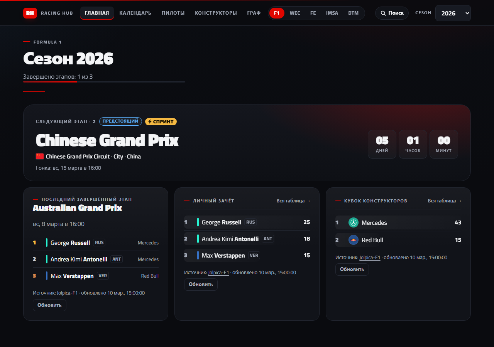</td>
    <td width="50%">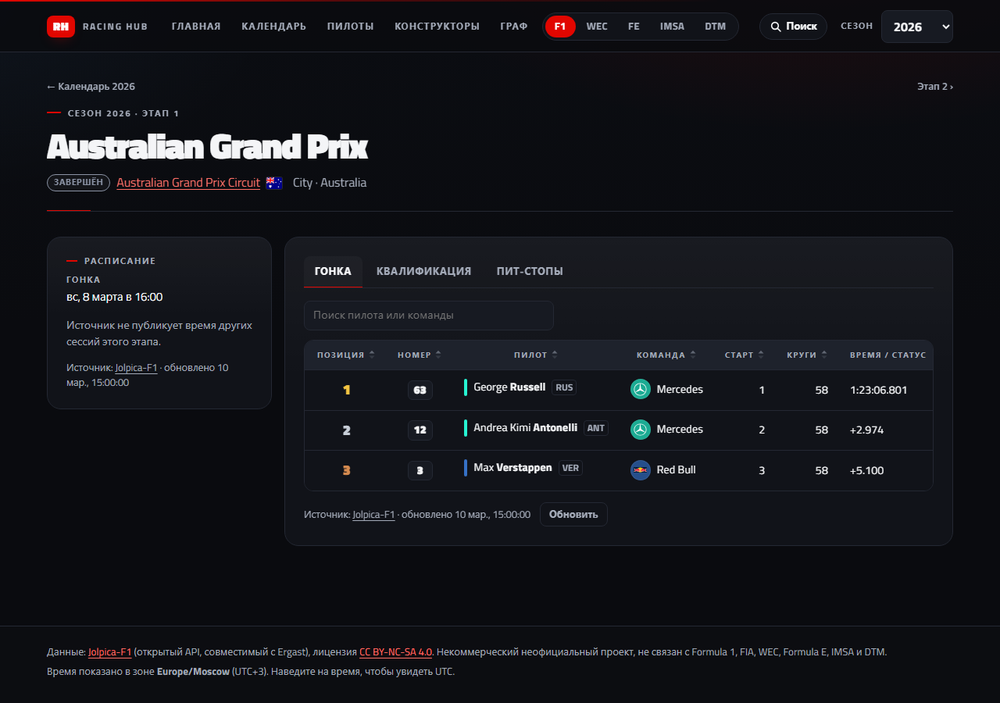</td>
  </tr>
  <tr>
    <td align="center"><b>Главная</b> — ближайший Гран-при и лидеры</td>
    <td align="center"><b>Этап</b> — схема трассы, расписание и результаты</td>
  </tr>
  <tr>
    <td>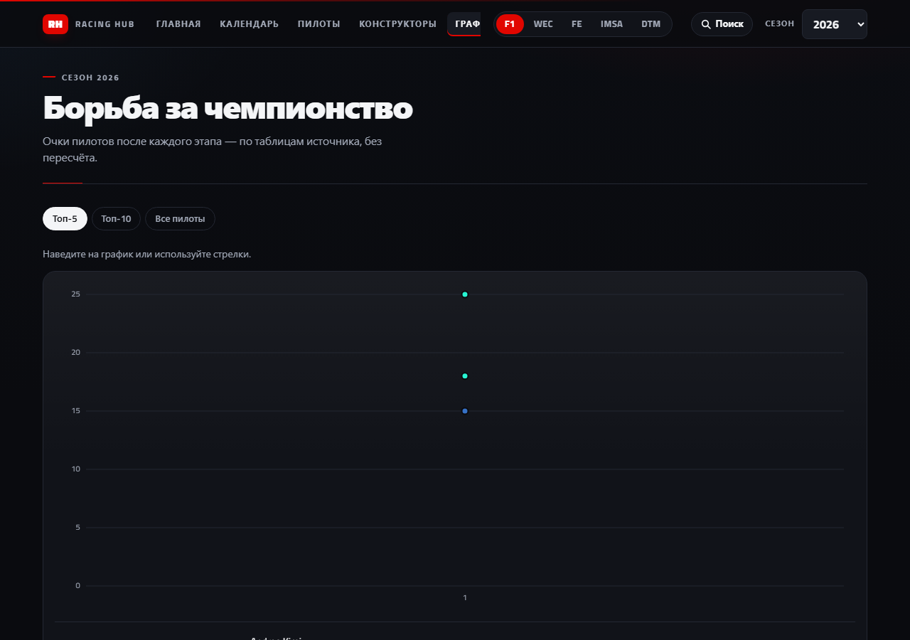</td>
    <td></td>
  </tr>
  <tr>
    <td align="center"><b>График</b> — борьба за титул по этапам</td>
    <td align="center"><b>Профиль</b> — сезон, карьера, фото</td>
  </tr>
</table>

Все сезоны с 1950 года. Квалификации у Jolpica есть с 1994 года, пит-стопы — с 2011. Тренировок и спринт-квалификации у источника нет.

## 🔵 WEC

Чемпионат мира по гонкам на выносливость с «24 часами Ле-Мана»: в одной гонке едут несколько классов (сейчас **Hypercar** и **LMGT3** — у них знаки «HYPER CAR» и «LM GT3» в цветной рамке), на одной машине — экипаж из 2–3 пилотов, гонка длится от нескольких часов до суток.

<table>
  <tr>
    <td width="50%">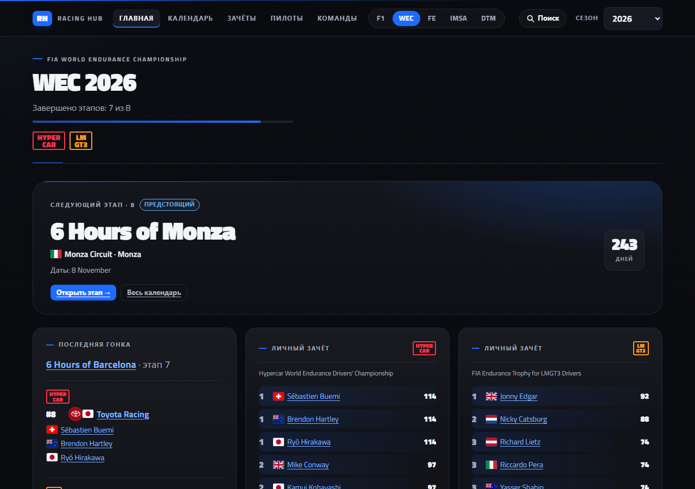</td>
    <td width="50%">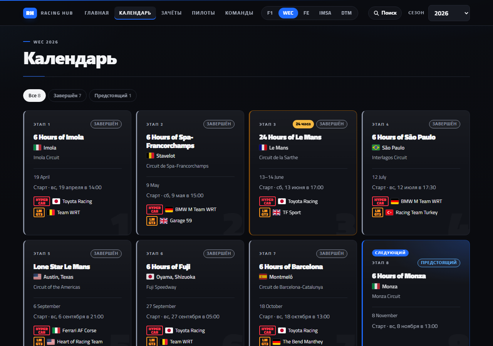</td>
  </tr>
  <tr>
    <td align="center"><b>Главная</b> — прогресс сезона и лидеры классов</td>
    <td align="center"><b>Календарь</b> — победители каждого класса</td>
  </tr>
  <tr>
    <td>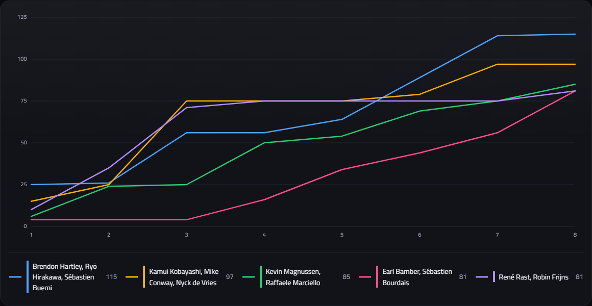</td>
    <td>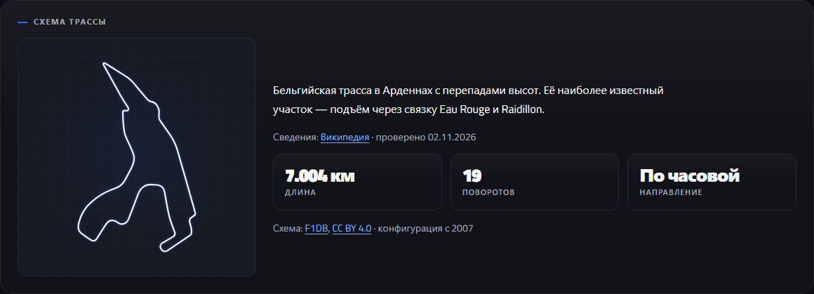</td>
  </tr>
  <tr>
    <td align="center"><b>График</b> — место экипажа в каждой гонке</td>
    <td align="center"><b>Трасса</b> — схема, длина, повороты</td>
  </tr>
</table>

> [!NOTE]
> Бесплатного стабильного API для WEC нет, поэтому данные берутся из английской Википедии: там все сезоны в одинаковых таблицах. Результаты появляются через несколько часов или на следующий день после гонки. График очков — по официальным зачётам после этапов. Подробнее — в [WEC README](src/series/wec/README.md).

## 🟣 Formula E

Чемпионат мира на электромобилях: городские трассы, этапы часто сдвоенные (две гонки в один уикенд), квалификация — группы и дуэли на выбывание. Вкладки и вид страниц — как у F1.

<table>
  <tr>
    <td width="50%">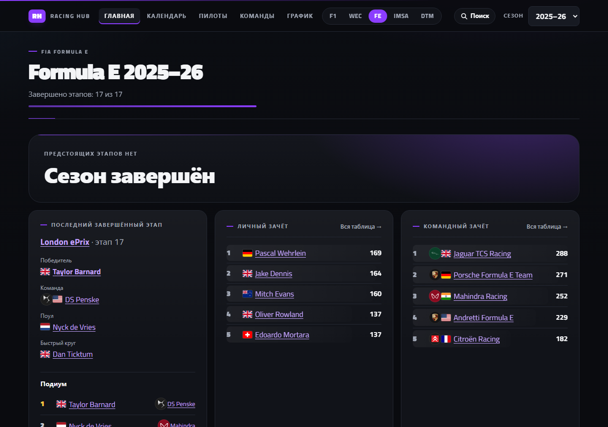</td>
    <td width="50%">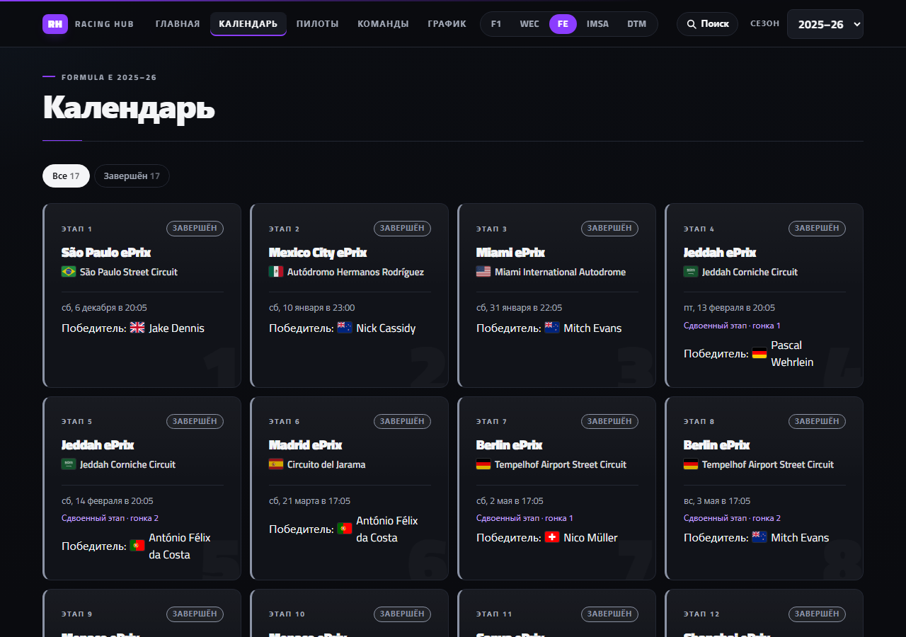</td>
  </tr>
  <tr>
    <td align="center"><b>Главная</b> — подиум, поул, быстрый круг и лидеры</td>
    <td align="center"><b>Календарь</b> — сдвоенные этапы и победители</td>
  </tr>
  <tr>
    <td>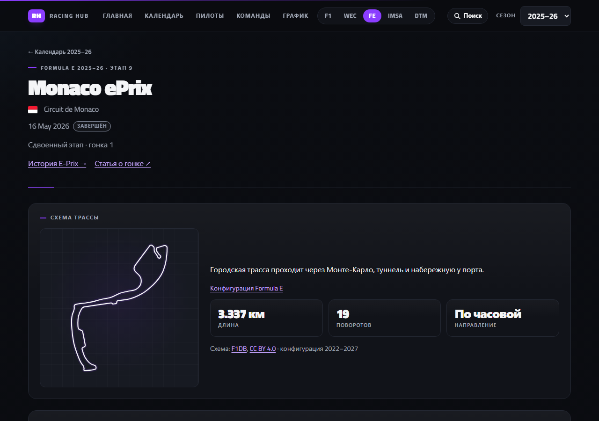</td>
    <td>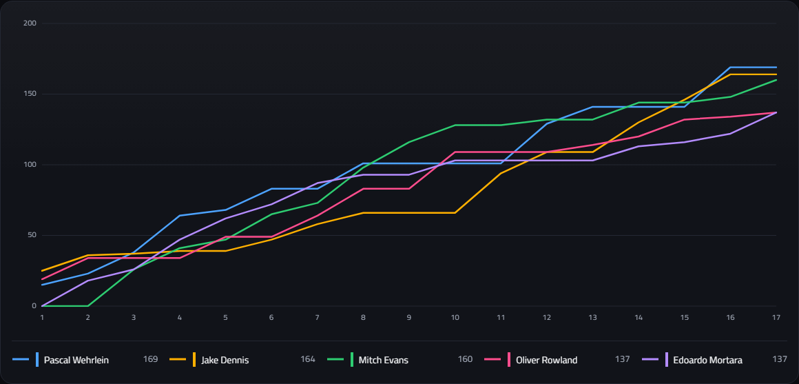</td>
  </tr>
  <tr>
    <td align="center"><b>Этап</b> — протокол, группы и дуэли</td>
    <td align="center"><b>Зачёты</b> — пилоты, команды, производители</td>
  </tr>
</table>

> [!NOTE]
> Календари, результаты и профили — из английской Википедии. График очков и результаты тренировок — из официальных классификаций FIA. Цифры карьеры в профилях — из карточки статьи, как их публикует Википедия. Фото машины команды показывается, только если в подписи снимка указана модель этого сезона. Подробнее — в [FE README](src/series/fe/README.md).

## 🟢 IMSA и 🟡 DTM

**IMSA** — гонки на выносливость в Северной Америке: несколько классов в одной гонке (GTP, LMP2, GTD Pro, GTD; в старых сезонах — DPi, GTLM, P, PC). **DTM** — немецкие кузовные гонки, две гонки на этапе.

<table>
  <tr>
    <td width="50%">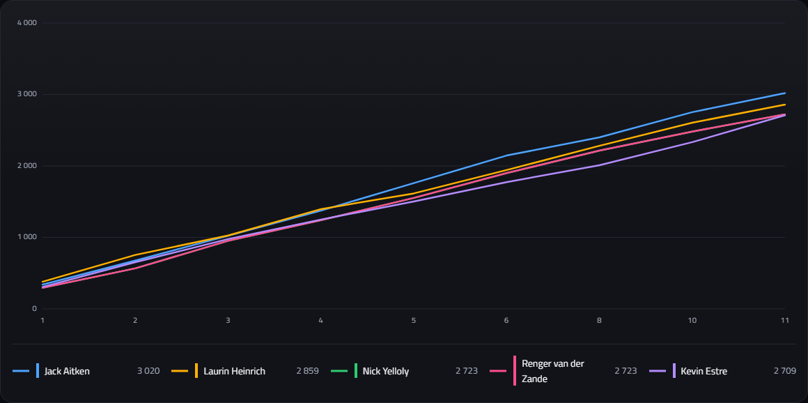</td>
    <td width="50%">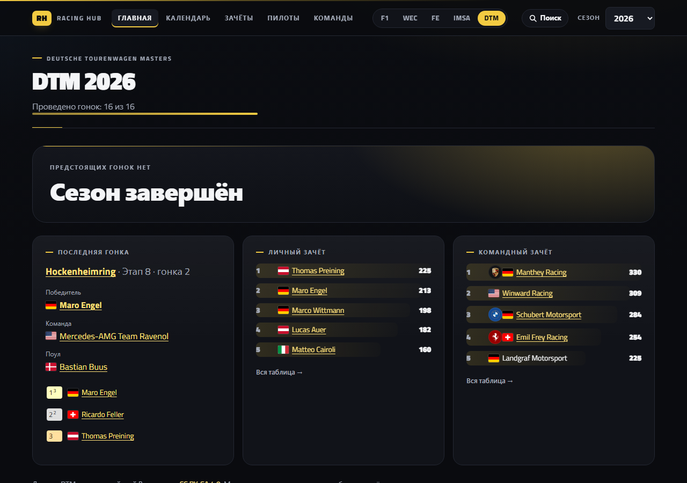</td>
  </tr>
  <tr>
    <td align="center"><b>IMSA</b> — зачёты классов и официальные очки после этапов</td>
    <td align="center"><b>DTM</b> — сезон, последняя гонка, лидеры</td>
  </tr>
</table>

- 🗓 **Гонка:** флаг и место, расписание уикенда, схема трассы, протокол (IMSA — победители классов и полный протокол; DTM — места с очками квалификации надстрочно), ниже — результаты всех сессий.
- 🏷 **Оформление:** знаки классов IMSA в цветной рамке, эмблемы марок (у команд — по машине из заявки), фото машины сезона из статьи о модели.
- 📈 **Графики очков:** IMSA — из официальных файлов очков после каждого этапа; DTM — сумма официальных очков за каждую гонку, сверенная с итогом сезона (не сходится — графика нет).
- 👥 **Участники:** заявки с номером, классом, машиной и этапами; профили пилота, команды и трассы из статей Википедии; сравнение двух пилотов.

## 🔎 Правила данных

- 📊 Очки и места — **как у источника**, сайт ничего не пересчитывает.
- ❔ Нет данных — «—» или «нет у источника», значения **не придумываются**.
- 🔗 Под каждым блоком — источник, время загрузки и кнопка «Обновить».
- 📷 Фото только с Wikimedia Commons и под свободной лицензией, автор подписан. Нет подходящего фото — нет фото.
- 🔐 Ни ключей API, ни регистрации, ни бэкенда: всё читается из открытых источников прямо в браузере.
- 💾 Если источник недоступен, показывается последняя сохранённая копия с пометкой.

<details>
<summary><b>Что обновляется само, а что — раз в сезон вручную</b></summary>

**Само**, при открытии страницы: календари, результаты, зачёты, заявки, профили и фото — новые пилоты, команды и гонки появляются без правок кода. Результаты сессий DTM — тоже напрямую из API.

**Вручную, раз в сезон** (скриптами из `scripts/`), потому что у источников нет открытого доступа из браузера или удобного формата:

- очки после каждого этапа для графиков WEC, Formula E, IMSA и DTM;
- расписания уикендов WEC и Formula E (с официальных страниц), IMSA и DTM (скриптом);
- результаты сессий IMSA и тренировок Formula E;
- схемы трасс, эмблемы новых марок, фото болидов F1.

Порядок — в [docs/MAINTENANCE.md](docs/MAINTENANCE.md#что-обновлять-вручную-раз-в-сезон).

</details>

## 🚀 Запуск

```bash
npm install
npm run dev
```

Откройте **http://localhost:5173**.

<details>
<summary><b>Все команды</b></summary>

| Команда                 | Что делает                                                                |
| ----------------------- | ------------------------------------------------------------------------- |
| `npm run dev`           | сайт для разработки с автообновлением                                     |
| `npm run build`         | проверка типов и сборка в `dist/`                                         |
| `npm run preview`       | просмотр собранного сайта                                                 |
| `npm test`              | модульные и компонентные тесты (Vitest)                                   |
| `npm run test:e2e`      | сквозные тесты в браузере (первый раз: `npx playwright install chromium`) |
| `npm run test:contract` | проверка живых источников: Jolpica и Википедии                            |
| `npm run test:visual`   | сравнение скриншотов страниц с эталонами                                  |
| `npm run lint`          | ESLint                                                                    |
| `npm run format`        | Prettier                                                                  |

</details>

## 🧱 Как устроено

**React 18** · **TypeScript (strict)** · **Vite 8** · **React Router 7** · **Vitest** · **Playwright** · **ESLint** · **Prettier** — без UI-библиотек и бэкенда, стили на обычном CSS, графики и схемы на SVG.

```text
src/
├── api/          HTTP-клиент, общий клиент Википедии и фото с Commons
├── components/   шапка, таблицы, фото, эмблемы, схема трассы, расписание, результаты сессий
├── data/         общие схемы трасс и эмблемы марок
├── hooks/        загрузка данных, время
├── lib/          даты, флаги, разбор таблиц, зачётов, заявок и статей Википедии, поиск
├── styles/       тема и стили разделов
└── series/
    ├── f1/       Formula 1: Jolpica, страницы, график очков
    ├── wec/      WEC: Википедия, классы, график очков
    ├── fe/       Formula E: Википедия и FIA, гонки и квалификация, профили, график очков
    ├── imsa/     IMSA: Википедия и официальные результаты, классы, протоколы
    └── dtm/      DTM: Википедия и API dtm.com, две гонки на этапе, сессии
scripts/          загрузка справочников: очки, расписания, сессии, схемы трасс
```

- Страницы серий загружаются **отдельными частями** через `lazy`.
- Серии **не импортируют друг друга**, общий код не зависит от серий — это проверяет ESLint.
- Сайт хостится на **GitHub Pages**: после пуша в `main` проверки прогоняются заново, и сайт публикуется, только если все они прошли.

<details>
<summary><b>Все адреса страниц</b></summary>

| Адрес                                           | Что показывает                                     |
| ----------------------------------------------- | -------------------------------------------------- |
| `#/`                                            | выбор чемпионата и «Сегодня в автоспорте»          |
| `#/f1`, `#/wec`, `#/fe`, `#/imsa`, `#/dtm`      | последний (или последний просмотренный) сезон      |
| `#/{season}`                                    | F1: главная сезона                                 |
| `#/{season}/calendar`, `/race/{round}`          | F1: календарь и этап                               |
| `#/{season}/drivers`, `/constructors`           | F1: личный зачёт и Кубок конструкторов             |
| `#/{season}/chart`, `/compare?a=…&b=…`          | F1: график чемпионства и сравнение                 |
| `#/{season}/driver/{id}`, `/constructor/…`      | F1: профили пилота и команды                       |
| `#/{season}/circuit/{id}`                       | F1: трасса и победители по годам                   |
| `#/about`                                       | F1: источники данных                               |
| `#/wec/{season}`                                | WEC: главная сезона                                |
| `#/wec/{season}/calendar`, `/race/{round}`      | WEC: календарь и этап                              |
| `#/wec/{season}/standings`                      | WEC: все зачёты и графики                          |
| `#/wec/{season}/drivers`, `/teams`              | WEC: заявочные списки с поиском                    |
| `#/wec/{season}/crews`                          | WEC: номера машин, составы экипажей и этапы        |
| `#/wec/{season}/compare?a=…&b=…`                | WEC: сравнение пилотов                             |
| `#/wec/{season}/driver/…`, `/team/…`            | WEC: профили пилота и команды (по названию статьи) |
| `#/wec/{season}/circuit/…`                      | WEC: трасса и победители гонки по годам            |
| `#/wec/{season}/about`                          | WEC: источники данных, фото, схем и эмблем         |
| `#/fe/{season}`                                 | FE: главная сезона                                 |
| `#/fe/{season}/calendar`, `/race/{round}`       | FE: календарь, гонка, квалификация и тренировки    |
| `#/fe/{season}/drivers`, `/teams`, `/chart`     | FE: личный и командный зачёт, график — как у F1    |
| `#/fe/{season}/entries`, `/entries/teams`       | FE: заявочные списки с поиском                     |
| `#/fe/{season}/driver/…`, `/team/…`, `/eprix/…` | FE: профили пилота, команды и E-Prix               |
| `#/fe/{season}/compare?a=…&b=…`                 | FE: сравнение пилотов                              |
| `#/fe/{season}/about`                           | FE: источники                                      |
| `#/imsa/{season}`, `/calendar`, `/standings`    | IMSA: главная, календарь, зачёты классов           |
| `#/imsa/{season}/race/{round}`                  | IMSA: протокол гонки, расписание и сессии          |
| `#/dtm/{season}`, `/calendar`, `/standings`     | DTM: главная, календарь, зачёты и график           |
| `#/dtm/{season}/race/{n}`                       | DTM: гонка (номер гонки в сезоне) и сессии этапа   |
| `#/imsa/…`, `#/dtm/…`: `/drivers`, `/teams`     | IMSA и DTM: заявки — пилоты, команды и экипажи     |
| `…/driver/…`, `/team/…`, `/circuit/…`           | IMSA и DTM: профили по названию статьи             |
| `…/compare?a=…&b=…`, `/about`                   | IMSA и DTM: сравнение пилотов и источники          |

</details>

## ✅ Качество

<div align="center">


</div>

Каждое изменение проходит модульные и компонентные тесты, сквозные сценарии в браузере, сравнение скриншотов страниц, проверку типов, ESLint и Prettier. Отдельная проверка каждый понедельник следит, что Jolpica и Википедия отвечают в прежнем формате. Результаты Formula 1 сверены с официальным сайтом. Цифры и даты прогонов — в [отчёте о тестировании](docs/TESTING.md), поддержка проекта — в [docs/MAINTENANCE.md](docs/MAINTENANCE.md).

## 📄 Права и источники

Racing Hub — **неофициальный фанатский проект**, сделанный для себя: без рекламы, платного доступа и доходов.

| Что                            | Откуда                                                                                                                                                                                                 | Лицензия                                                                        |
| ------------------------------ | ------------------------------------------------------------------------------------------------------------------------------------------------------------------------------------------------------ | ------------------------------------------------------------------------------- |
| Данные Formula 1               | [Jolpica-F1](https://github.com/jolpica/jolpica-f1)                                                                                                                                                    | [CC BY-NC-SA 4.0](https://creativecommons.org/licenses/by-nc-sa/4.0/)           |
| Сезоны, гонки, зачёты, профили | [английская Википедия](https://en.wikipedia.org/) (WEC, Formula E, IMSA, DTM), ссылка на статью — под каждым блоком                                                                                    | [CC BY-SA 4.0](https://creativecommons.org/licenses/by-sa/4.0/)                 |
| Очки по этапам, сессии         | официальные источники серий: fiawec.com, классификации FIA Formula E, результаты IMSA, api.dtm.com — ссылка на странице «Источники» каждой серии                                                       | данные организаторов                                                            |
| Схемы трасс                    | [F1DB](https://github.com/f1db/f1db); © [участники OpenStreetMap](https://www.openstreetmap.org/copyright) через [track-atlas](https://github.com/tobi/track-atlas); карты Commons, автор — под схемой | CC BY 4.0; [ODbL 1.0](https://opendatacommons.org/licenses/odbl/1-0/); CC BY-SA |
| Фото                           | [Wikimedia Commons](https://commons.wikimedia.org/), автор и лицензия — под каждым фото                                                                                                                | свободные лицензии авторов                                                      |
| Флаги                          | [flag-icons](https://github.com/lipis/flag-icons); редкие страны, которых нет в наборе, — из Википедии                                                                                                 | MIT; общественное достояние                                                     |
| Эмблемы                        | Commons и Википедия; источник каждой — в [logos.ts](src/series/f1/data/logos.ts) и [emblems.ts](src/data/emblems.ts) и на страницах «Источники»                                                        | товарные знаки владельцев                                                       |

«Formula 1», «F1», «FIA», «WEC», «Formula E», «IMSA», «DTM», названия и логотипы команд — товарные знаки их владельцев. Эмблемы нужны только чтобы обозначить участника. Если вы правообладатель и хотите убрать материал, [создайте issue](https://github.com/Ait102/racinghub/issues) — он будет удалён.
